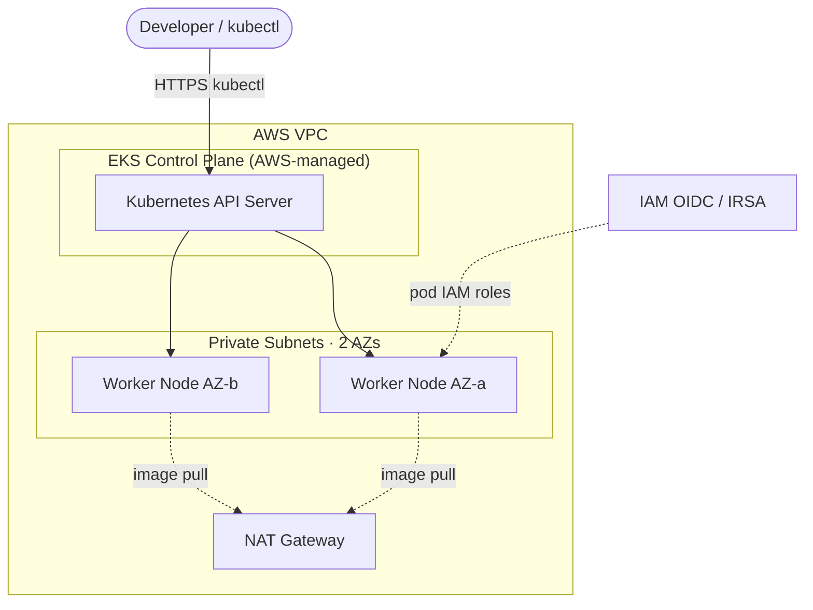

# AWS EKS Kubernetes Platform (Terraform)

> Production-style Amazon EKS cluster with a managed node group and IRSA — all provisioned with Terraform.
> **Author:** Muhammad Ahmad · **IaC:** Terraform · **Cloud:** AWS


---

## 📌 Overview

A ready-to-use **Amazon EKS** platform:

- **Dedicated VPC** with public + private subnets across 2 AZs, NAT Gateway, and the subnet tags EKS needs for load balancers.
- **EKS control plane** (managed by AWS) with public + private endpoint access.
- **Managed node group** running worker nodes in **private subnets**, with autoscaling bounds.
- **IRSA** — an IAM OIDC provider so pods can assume fine-grained IAM roles (no node-wide credentials).

## 🏗️ Architecture

> 🎨 **Interactive diagram (industry-standard icons):** [open in Lucid — page 4](https://lucid.app/lucidchart/3da75ce3-ea66-4296-81b3-00d20a60435b/edit)



## 🚀 Deploy

**Prerequisites:** Terraform ≥ 1.5, AWS credentials, `kubectl`, `aws` CLI.

```bash
cd terraform
terraform init
terraform apply   # provisioning EKS takes ~15 minutes
```

Connect `kubectl`:

```bash
$(terraform output -raw update_kubeconfig_command)
kubectl get nodes
```

## 🧹 Clean up

```bash
terraform destroy
```

## 💰 Cost note

The **EKS control plane (~$0.10/hr)**, NAT Gateway, and worker EC2 instances bill hourly and are **not free-tier**. Destroy when finished.

## 🔐 Production hardening (next steps)

- Restrict the API endpoint to private + known CIDRs.
- Add the **AWS Load Balancer Controller** and **cluster-autoscaler** via IRSA.
- Add managed add-ons (CoreDNS, kube-proxy, VPC CNI) with pinned versions.
- Enable control-plane logging to CloudWatch.

---

*Built and maintained by **Muhammad Ahmad**.*
