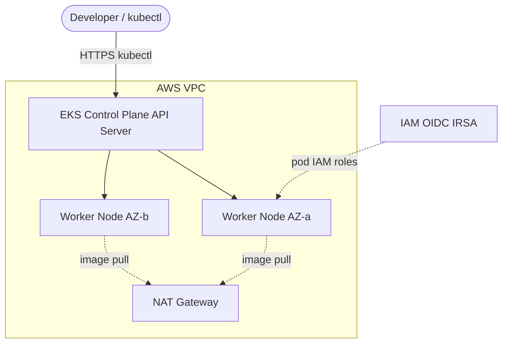

# Architecture Diagram — AWS EKS Kubernetes Platform

## Lucid diagram

- **View:** https://lucid.app/lucidchart/eaff9aff-df8d-4b18-a90b-3544cbecfc83/view
- **Edit:** https://lucid.app/lucidchart/eaff9aff-df8d-4b18-a90b-3544cbecfc83/edit

## Lucid prompt (reusable)

```
Create an AWS architecture diagram titled "AWS EKS Kubernetes Platform".
A Developer uses kubectl over HTTPS to reach the EKS Control Plane (AWS-managed
Kubernetes API server). Inside a VPC, private subnets across 2 AZs hold worker
nodes in a managed node group; the API server manages the nodes. Nodes pull images
through a NAT Gateway. An IAM OIDC provider (IRSA) grants pod-level IAM roles.
Clean, professional AWS/Kubernetes colors.
```

## Mermaid source


